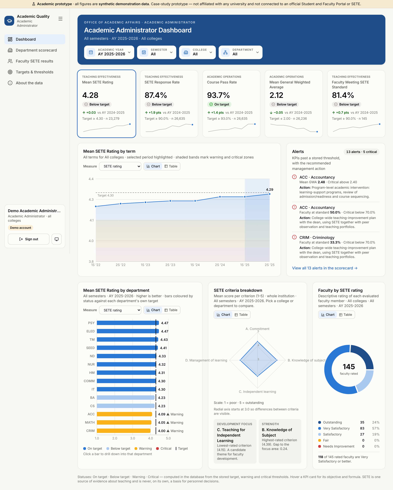

# Academic Quality Dashboard — SETE & Academic Performance Analytics

> **Academic prototype for the BAT 405 case study** “Enhancing the University Student and Faculty Portal Through Analytics and
> Decision Support”, set in the context of Batangas State University — The National Engineering University. It is **not affiliated
> with or endorsed by the university** and is **not integrated** with its Student and Faculty Portal or SETE (Student Evaluation of
> Teaching Effectiveness). Every student, faculty member, grade and evaluation is **synthetic demonstration data**.

A database-backed decision-support dashboard for **one primary user: the Authorized Academic Administrator** (e.g. the Office of the
Vice President for Academic Affairs). It combines Student and Faculty Portal records (enrolment, final grades) with SETE results to
monitor academic performance and teaching effectiveness.

| | |
|---|---|
| **Live app** | **https://sete-analytics-dashboard.vercel.app** (health check: [`/api/health`](https://sete-analytics-dashboard.vercel.app/api/health)) |
| **Repository** | https://github.com/felman3/Steal-An-Egg-Diff (branch `claude/sweet-franklin-7ux0p5`) |
| **Database** | Supabase PostgreSQL 17 (project `ulcnqgrvqgnihwenqech`, region `ap-northeast-2`) |
| **Docs** | [Case study answers (Parts I–V)](docs/CASE_STUDY.md) · [Database schema](docs/DATABASE.md) · [Security](docs/SECURITY.md) · [Deployment](docs/DEPLOYMENT.md) |

## Demo access

Public sign-up is disabled. The login page has a one-click button for the primary user.

| Account | Email | Password | Result |
|---|---|---|---|
| **Academic Administrator** (primary user) | `demo.academic.admin@example.com` | `Demo-SETE-2026` | Full dashboard |
| Unauthorized test account | `demo.unauthorized@example.com` | `Demo-SETE-2026` | Signs in, then **Access denied**; the database returns no data |

The second account exists only to demonstrate that confidential data can't be reached by anyone who isn't an authorized academic
administrator. Demo credentials can't be changed by visitors.

## Case-study requirements → where they are

| Requirement (Part III) | In the dashboard |
|---|---|
| One primary user | **Authorized Academic Administrator**; the only role the system grants |
| **Five KPI cards** | Mean SETE rating · SETE response rate · Course pass rate · Mean GWA · Faculty meeting SETE standard |
| **Three data visualizations** (four provided) | ① KPI trend by term (line + area) · ② KPI by department (horizontal bars) · ③ SETE criteria breakdown (radar) · ④ Faculty by SETE rating (donut) |
| **Two interactive features** | ① Filter chips in the header: academic year, semester, college, department · ② Drill-down: click a department bar to filter the whole dashboard to it (plus KPI hover cards, the measure switch, chart/table toggle and collapsible sidebar) |
| **Warning / alert mechanism** | Alerts panel with recommended management action · status badges · warning/critical bands on the trend chart · "interpret with caution" on SETE cards when the response rate is low |
| KPI objective, formula, target, management action (Part II) | Stored in `kpi_definitions` / `kpi_targets`; shown on the About page and in KPI-card tooltips |
| Two warning thresholds | Warning and critical thresholds per KPI, editable on **Targets & thresholds** |
| Responsible SETE interpretation | Response rate beside SETE, low-response flags, small-sample suppression, responsible-use notice |
| Protect confidential data | Row-Level Security + authorization in every analytics function; anonymous SETE; audit trail |



## The five KPIs

| # | KPI | Category | Formula | Better | Target / warning / critical |
|---|---|---|---|---|---|
| 1 | Mean SETE rating | Teaching effectiveness | Σ criterion scores ÷ count (1–5) | Higher | 4.30 / 4.10 / 3.90 |
| 2 | SETE response rate | Teaching effectiveness | Evaluations ÷ eligible enrolments | Higher | 90% / 80% / 70% |
| 3 | Course pass rate | Academic operations | Passing grades (1.00–3.00) ÷ eligible enrolments | Higher | 93% / 88% / 83% (CHS 88/83/78) |
| 4 | Mean GWA | Academic operations | Σ(grade × units) ÷ Σ units | Lower | 2.00 / 2.20 / 2.40 (CHS 2.20/2.40/2.60) |
| 5 | Faculty meeting SETE standard | Teaching effectiveness | % of evaluated faculty with mean ≥ 4.00 | Higher | 90% / 80% / 70% |

Statuses are computed **in the database** from the stored thresholds: *On target → Below target → **Warning** → **Critical***.
Objectives and management actions per KPI are in [docs/CASE_STUDY.md](docs/CASE_STUDY.md#part-ii-kpi-identification-and-design).

## Architecture

```
Browser (React 19 + TypeScript + Vite + Tailwind 4 + Recharts 3)
   │  supabase-js with the PUBLISHABLE key + the signed-in user's token
   ▼
Supabase ── Auth (email/password, sign-up disabled)
        └─ PostgreSQL 17
              • 20 tables, Row-Level Security on every one: academic administrators only
              • analytics functions that check authorization, then return aggregates
              • materialized fact views (private schema, not exposed)
Vercel ── static SPA (client-side routing, security headers, CSP)
       └─ /api/health  serverless function (server-side database check)
```

## Project layout

```
api/health.ts                     Vercel serverless function
src/                              React app (pages, components, charts, auth, filters)
supabase/migrations/              Schema · RLS & security · analytics · academic-admin-only access
supabase/seed/                    Deterministic synthetic data (5 steps)
scripts/db/apply.mjs              Apply migrations / seed through the Supabase Management API
scripts/db/create-demo-users.mjs  Create or reset the demo accounts
scripts/test/verify-security.mjs  31 live access-control checks
tests/e2e/                        Playwright end-to-end tests
docs/                             Case study, database, security and deployment documentation
```

## Local development

```bash
npm ci
```

```bash
cp .env.example .env.local    # then fill in the Supabase URL + publishable key + demo password
```

```bash
npm run dev                   # http://localhost:5173
```

Quality gates:

```bash
npm run typecheck && npm run lint && npm run build
```

```bash
npm run test:e2e              # Playwright, against a local preview build
```

```bash
npm run test:security         # live access-control checks (needs .env.local)
```

## Verification

- Type-check and lint pass with 0 problems, and the production build succeeds.
- **13/13** Playwright tests pass. They cover sign-in, the collapsible sidebar, the 5 KPI cards with categories, alerts with actions, all 3 charts, all four
  filters, department drill-down, the empty state, the responsible-use notice, the unauthorized account being denied, and mobile layout.
- **31/31** live access-control checks pass. The unauthorized account reads 0 rows from every table and is refused every analytics function.

## Limitations

- Synthetic data only; no integration with the official Student and Faculty Portal or SETE (integration is the *proposed* solution).
- The shared demo administrator can change targets. **Restore defaults** resets them, and every change is in the audit trail.
- Faculty are pseudonymised ("Faculty CS-07"); a real deployment would need a privacy impact assessment under the Data Privacy Act of 2012.
