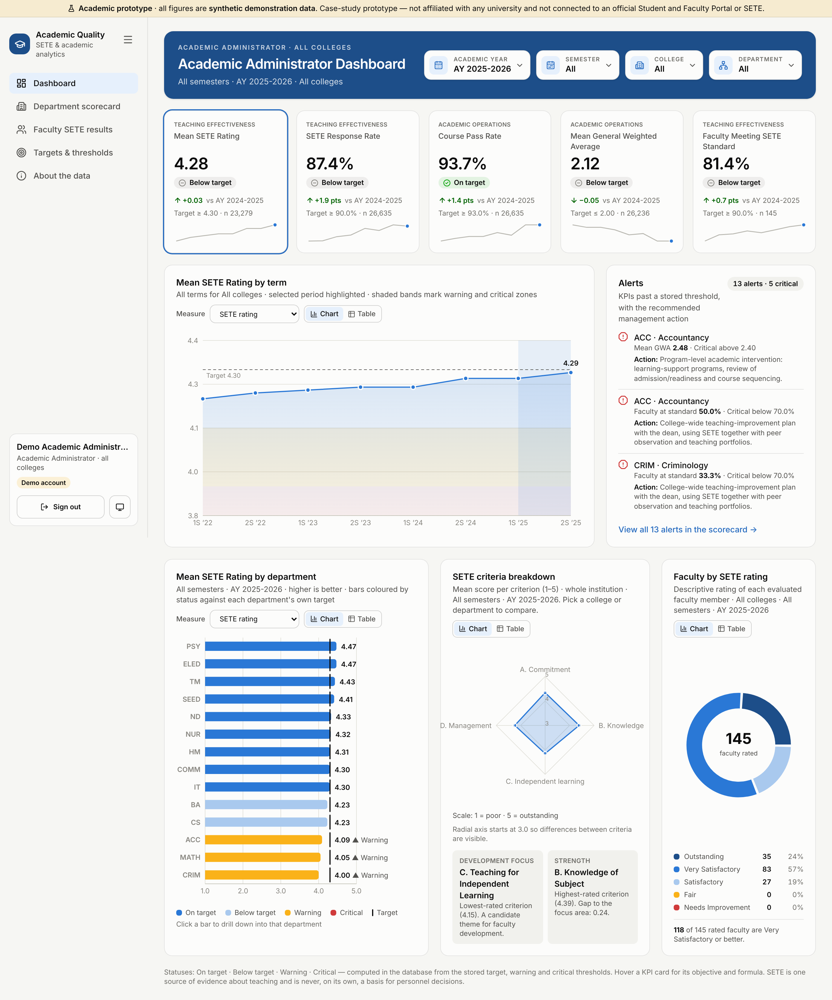
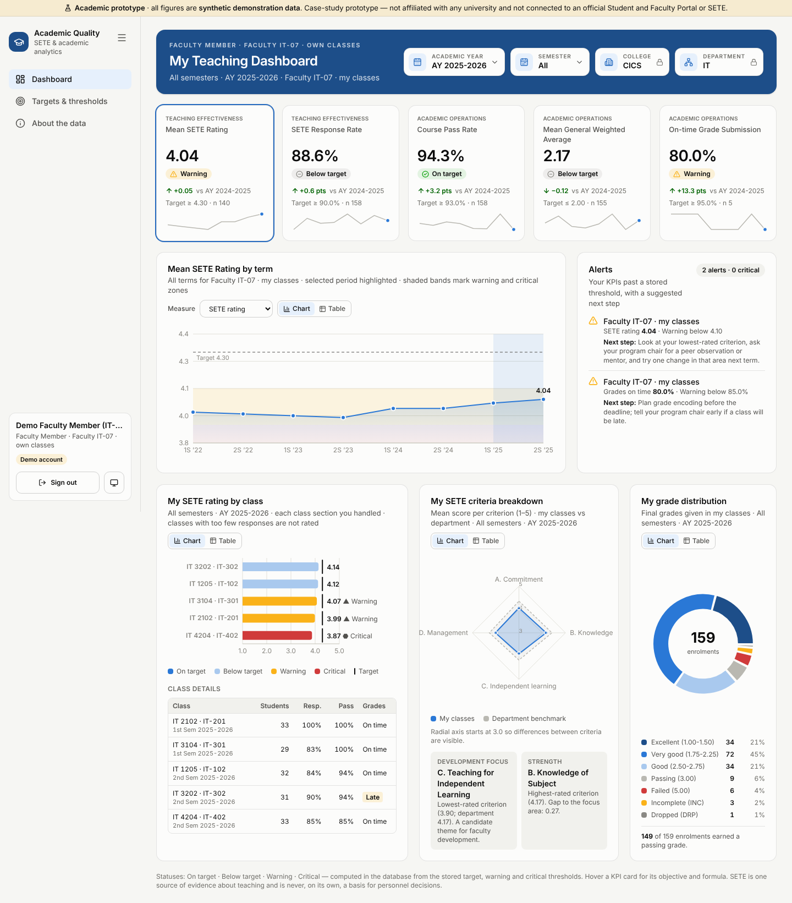

# Academic Quality Dashboard — SETE & Academic Performance Analytics

> **Academic prototype for the BAT 405 case study** “Enhancing the University Student and Faculty Portal Through Analytics and
> Decision Support”, set in the context of Batangas State University — The National Engineering University. It is **not affiliated
> with or endorsed by the university** and is **not integrated** with its Student and Faculty Portal or SETE (Student Evaluation of
> Teaching Effectiveness). Every student, faculty member, grade and evaluation is **synthetic demonstration data**.

A database-backed decision-support dashboard that combines Student and Faculty Portal records (enrolment, final grades, grade
submission) with SETE results. It serves the **four user types** named in the case study, each with a dashboard limited to their
own scope: **Authorized Academic Administrator**, **Dean**, **Program Chair** and **Faculty Member**.

| | |
|---|---|
| **Live app** | **https://sete-analytics-dashboard.vercel.app** (health check: [`/api/health`](https://sete-analytics-dashboard.vercel.app/api/health)) |
| **Repository** | https://github.com/felman3/Steal-An-Egg-Diff (branch `claude/sweet-franklin-7ux0p5`) |
| **Database** | Supabase PostgreSQL 17 (project `ulcnqgrvqgnihwenqech`, region `ap-northeast-2`) |
| **Docs** | [Case study answers (Parts I–V)](docs/CASE_STUDY.md) · [Database schema](docs/DATABASE.md) · [Security](docs/SECURITY.md) · [Deployment](docs/DEPLOYMENT.md) |

## Demo access

Public sign-up is disabled. The login page has a one-click button for each account. **Password for all: `password`**

| User type | Email | Dashboard |
|---|---|---|
| Academic Administrator | `admin@example.com` | Whole university; edits targets and thresholds |
| Dean | `dean@example.com` | College of Informatics and Computing Sciences (CICS) |
| Program Chair | `chair@example.com` | BS Information Technology program |
| Faculty Member | `faculty@example.com` | Own classes only (pseudonym "Faculty IT-07") |

Demo credentials can't be changed by visitors. `noaccess@example.com` (same password, not on the login page) has no dashboard
role and is denied all data; the tests use it.

## What each user sees

Same layout and design for everyone: filter chips, five KPI cards, alerts, a trend chart and three more charts. The content changes:

| | Academic Administrator | Dean | Program Chair | Faculty Member |
|---|---|---|---|---|
| **Scope** | All colleges | Own college (locked) | Own program (locked) | Own classes (locked) |
| **Filters** | Year, semester, college, department | Year, semester, department | Year, semester | Year, semester |
| **5 KPI cards** | SETE rating · Response rate · Pass rate · GWA · Faculty meeting standard | Same, for the college | Same, for the program | **My** SETE rating · response rate · pass rate · class GWA · **on-time grade submission** |
| **Trend chart** | Any KPI by term | College | Program | My own results by term |
| **Comparison chart** | By department (click to drill down) | Departments of the college + mini scorecard | **By faculty member** | **By class**, with class details |
| **SETE criteria radar** | Selection vs institution | College vs institution | Program vs institution | **Mine vs my department** |
| **Donut** | Faculty by SETE rating | College faculty by rating | Program faculty by rating | **My grade distribution** |
| **Alerts** | KPIs and departments past thresholds, with management action | + faculty in the critical zone | + every flagged faculty member | Own KPIs, with a suggested next step |
| **Other pages** | Scorecard, faculty results, targets (edit), about | Scorecard, faculty results, targets (read) | Scorecard, faculty results, targets (read) | Targets (read), about |

| Administrator | Faculty member |
|---|---|
|  |  |

Dean and Program Chair: [`dashboard-dean.png`](docs/screenshots/dashboard-dean.png), [`dashboard-chair.png`](docs/screenshots/dashboard-chair.png).

## Case-study requirements (Part III), met by every dashboard

| Requirement | Where |
|---|---|
| **Five KPI cards** | Top row, each labelled *Academic operations* or *Teaching effectiveness* |
| **Three data visualizations** (four provided) | Trend line with area · comparison bars · SETE criteria radar · donut |
| **Two interactive features** | Filter chips (academic year, semester, college, department) · click a department bar to drill down · plus KPI hover cards, measure switch, chart/table toggle |
| **Warning / alert mechanism** | Alerts panel with an action · status badges · warning and critical bands on the trend chart · low-response caution on SETE cards |
| Confidential data protected | Row-Level Security and an authorization check in every analytics function (see [Security](docs/SECURITY.md)) |

## The KPIs

| # | KPI | Category | Formula | Better | Target / warning / critical |
|---|---|---|---|---|---|
| 1 | Mean SETE rating | Teaching effectiveness | Σ criterion scores ÷ count (1–5) | Higher | 4.30 / 4.10 / 3.90 |
| 2 | SETE response rate | Teaching effectiveness | Evaluations ÷ eligible enrolments | Higher | 90% / 80% / 70% |
| 3 | Course pass rate | Academic operations | Passing grades (1.00–3.00) ÷ eligible enrolments | Higher | 93% / 88% / 83% (CHS 88/83/78) |
| 4 | Mean GWA | Academic operations | Σ(grade × units) ÷ Σ units | Lower | 2.00 / 2.20 / 2.40 (CHS 2.20/2.40/2.60) |
| 5 | Faculty meeting SETE standard *(admin, dean, chair)* | Teaching effectiveness | % of evaluated faculty with mean ≥ 4.00 | Higher | 90% / 80% / 70% |
| 5 | On-time grade submission *(faculty member)* | Academic operations | Sections with grades in by the deadline ÷ sections handled | Higher | 95% / 85% / 75% |

Statuses are computed **in the database** from the stored thresholds: *On target → Below target → **Warning** → **Critical***.
Objectives and management actions per KPI are in [docs/CASE_STUDY.md](docs/CASE_STUDY.md#part-ii-kpi-identification-and-design).

## Architecture

```
Browser (React 19 + TypeScript + Vite + Tailwind 4 + Recharts 3)
   │  supabase-js with the PUBLISHABLE key + the signed-in user's token
   ▼
Supabase ── Auth (email/password, sign-up disabled)
        └─ PostgreSQL 17
              • 20 tables, Row-Level Security on every one, scoped by role
              • analytics functions that resolve the caller's scope, then return aggregates
              • materialized fact views (private schema, not exposed)
Vercel ── static SPA (client-side routing, security headers, CSP)
       └─ /api/health  serverless function (server-side database check)
```

## Project layout

```
api/health.ts                     Vercel serverless function
src/                              React app (pages, components, charts, auth, filters)
supabase/migrations/              Schema · RLS & security · analytics · roles and per-role dashboards
supabase/seed/                    Deterministic synthetic data (5 steps)
scripts/db/apply.mjs              Apply migrations / seed through the Supabase Management API
scripts/db/create-demo-users.mjs  Create or reset the demo accounts
scripts/test/verify-security.mjs  56 live access-control checks across the four roles
tests/e2e/                        Playwright end-to-end tests
docs/                             Case study, database, security and deployment documentation
```

## Local development

```bash
npm ci
```

```bash
cp .env.example .env.local    # then fill in the Supabase URL + publishable key + demo password
```

```bash
npm run dev                   # http://localhost:5173
```

Quality gates:

```bash
npm run typecheck && npm run lint && npm run build
```

```bash
npm run test:e2e              # Playwright, against a local preview build
```

```bash
npm run test:security         # live access-control checks (needs .env.local)
```

## Verification

- Type-check and lint pass with 0 problems, and the production build succeeds.
- **16/16** Playwright tests pass: sign-in, the administrator's KPIs, charts, filters, drill-down and empty state, then each of
  the dean, program chair and faculty dashboards (scope locks, role-specific charts, blocked pages), an account with no role, and mobile layout.
- **56/56** live access-control checks pass (`npm run test:security`): each role reads only its own scope from the database.

## Limitations

- Synthetic data only; no integration with the official Student and Faculty Portal or SETE (integration is the *proposed* solution).
- The demo password is deliberately simple and public; the accounts hold synthetic data only.
- The shared demo administrator can change targets. **Restore defaults** resets them, and every change is in the audit trail.
- Faculty are pseudonymised ("Faculty CS-07"); a real deployment would need a privacy impact assessment under the Data Privacy Act of 2012.
