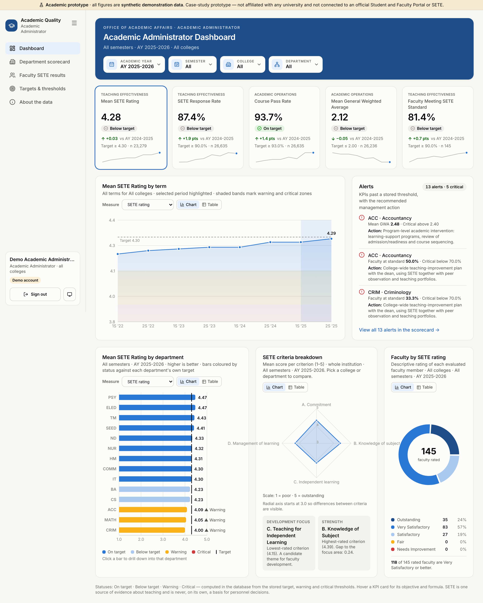

# BAT 405 Case Study — Enhancing the University Student and Faculty Portal Through Analytics and Decision Support

> **Draft for the group to review and adapt.** This document answers Parts I–V of the case study using the system in this
> repository. Rewrite it in your own words and adjust it to what your group observed about the actual portal before submitting.
>
> **Context and disclaimer.** The case is set at Batangas State University — The National Engineering University. This prototype is
> **not affiliated with or endorsed by the university**, is **not integrated** with its Student and Faculty Portal or SETE, and uses
> **synthetic demonstration data only**. Integration between the portal and SETE is a *proposed* enhancement, not an existing capability.

| | |
|---|---|
| **App name** | Academic Quality Dashboard — SETE & Academic Performance Analytics |
| **Primary user** | **Authorized Academic Administrator** (e.g. Office of the Vice President for Academic Affairs / quality-assurance office) |
| **Live dashboard** | https://sete-analytics-dashboard.vercel.app (demo sign-in: `demo.academic.admin@example.com` / `Demo-SETE-2026`) |
| **Repository** | https://github.com/felman3/Steal-An-Egg-Diff |

---

## Part I. Existing System Assessment

### Primary functions of the Student and Faculty Portal (existing)
- **Students:** online enrolment / registration, viewing class schedules and assessment of fees, viewing grades, printing
  certificates of registration and grade reports, updating personal information.
- **Faculty:** viewing teaching load and class lists, encoding and submitting final grades, viewing schedules.
- **Administration:** record keeping for enrolment, sections, grades and faculty assignments.

The portal is primarily **transactional**: it records and displays individual transactions, but does not summarise them for decisions.

### How SETE contributes (existing)
The Student Evaluation of Teaching Effectiveness lets students rate each faculty member every term on established criteria. This
prototype models four criteria, each rated 1–5 (the mean of five items):

| Criterion | Focus |
|---|---|
| A. Commitment | sensitivity to students, availability, punctuality, fair and prompt feedback |
| B. Knowledge of Subject | mastery of content and relating it to current practice |
| C. Teaching for Independent Learning | strategies that build self-direction and critical thinking |
| D. Management of Learning | structuring the learning environment, interaction, use of materials |

SETE provides the **students' perspective** on teaching. It is one source of evidence and should be read with other evidence (Part II).

### Data available from both systems (at least five)
| # | Data | Source |
|---|---|---|
| 1 | Enrolment records (student, section, term, units) | Portal |
| 2 | Final grades and remarks (1.00–3.00 passed, 5.00 failed, INC, DRP) | Portal |
| 3 | Class sections and faculty teaching assignments | Portal |
| 4 | Student and program attributes (program, year level, block section) | Portal |
| 5 | Grade submission dates vs. deadlines | Portal |
| 6 | SETE responses: scores per criterion per evaluation form (anonymous) | SETE |
| 7 | SETE participation: number of forms submitted per section | SETE |
| 8 | Academic calendar: academic years, semesters, SETE windows | Both |

### Limitations and opportunities
| Limitation (current) | Opportunity (proposed) |
|---|---|
| Portal and SETE are **separate**; results cannot be related to course outcomes | Integrate both into one analytics database (proposed solution) |
| Reports are per transaction (per student, per class), not aggregated | KPIs aggregated by academic year, semester, college and department |
| No **targets** or **thresholds**, so problems are noticed late | Targets and warning/critical thresholds stored in the database, with automatic alerts |
| SETE results are not shown with their **response rate**, so low-participation results can be over-interpreted | Response rate shown beside SETE; low-response results flagged "interpret with caution" |
| No trend view across terms | Trend charts across all semesters |
| Access to confidential results may rely on manual handling | Role-restricted, audited access enforced by the database |

### Stakeholders and decisions
| Stakeholder | Decisions supported |
|---|---|
| **Academic administrator (primary user)** | Set institutional targets; identify colleges/departments needing intervention; plan faculty-development programs; allocate tutorial / support resources |
| Deans / program chairs | Course and faculty assignments, curriculum review, mentoring |
| Faculty members | Self-improvement on the weakest SETE criterion |
| Students | (indirect) better teaching and support services |
| QA / accreditation offices | Evidence for accreditation and quality reviews |

---

## Part II. KPI Identification and Design

Two KPIs measure **academic operations** and three measure **teaching effectiveness** (one of which, the response rate, measures how
much SETE results can be trusted). All targets are **stored in the database** (`kpi_targets`) and editable by the academic administrator.

| KPI | Objective | Formula | Target | Management action |
|---|---|---|---|---|
| **1. Mean SETE Rating** *(teaching effectiveness)* | Monitor overall quality of instruction as perceived by students | Σ criterion scores ÷ number of criterion scores (1–5 scale) | **≥ 4.30** | *Warning:* chair reviews the criteria breakdown with the faculty and plans targeted development. *Critical:* dean-led instructional review combining SETE with peer observation, course outcomes and response rate |
| **2. SETE Response Rate** *(teaching effectiveness / data quality)* | Make SETE results representative enough to interpret | evaluations submitted ÷ eligible enrolments (dropped excluded) × 100 | **≥ 90%** | *Warning:* portal reminders, longer evaluation window, class time for evaluation; mark results low-confidence. *Critical:* treat SETE results as inconclusive for the term |
| **3. Course Pass Rate** *(academic operations)* | Monitor student success in enrolled courses | passing final grades (1.00–3.00) ÷ eligible enrolments × 100 | **≥ 93%** (College of Health Sciences **≥ 88%**) | *Warning:* review assessments and grade distribution; tutorial/remedial sessions; early advising. *Critical:* program review and intervention plan for at-risk students |
| **4. Mean General Weighted Average** *(academic operations)* | Track overall academic achievement (1.00 is best) | Σ(final grade × units) ÷ Σ units, graded enrolments | **≤ 2.00** (College of Health Sciences **≤ 2.20**) | *Warning:* review grading consistency and student support. *Critical:* program-level learning-support and readiness review |
| **5. Faculty Meeting SETE Standard** *(teaching effectiveness)* | Share of faculty meeting the institutional teaching standard, for development planning | faculty with mean rating ≥ 4.00 ÷ faculty with ≥ 5 responses × 100 | **≥ 90%** | *Warning:* faculty-development program on the weakest criterion; mentoring pairs. *Critical:* college-wide teaching-improvement plan using SETE plus peer observation and portfolios |

### Relevance to university objectives
- **Mean SETE rating** and **faculty meeting standard** support the objective of **quality instruction** and guide faculty development.
- **Response rate** protects the **validity** of SETE: decisions should not rest on results from a few students.
- **Pass rate** and **GWA** reflect **student success and academic excellence**, and differentiated targets acknowledge that licensure
  programs (e.g. Nursing in the College of Health Sciences) are harder.

### Warning thresholds (two levels per KPI, stored in `kpi_targets`)
| KPI | Warning (intervene) | Critical (escalate) |
|---|---|---|
| Mean SETE rating | below **4.10** | below **3.90** |
| SETE response rate | below **80%** | below **70%** |
| Course pass rate | below **88%** (CHS 83%) | below **83%** (CHS 78%) |
| Mean GWA | above **2.20** (CHS 2.40) | above **2.40** (CHS 2.60) |
| Faculty meeting standard | below **80%** | below **70%** |

Status ladder computed in the database: **On target → Below target (no alert) → Warning → Critical**.

### Interpreting SETE results responsibly
1. **Never the sole measure.** SETE is the students' perspective; combine it with peer/classroom observation, teaching portfolios,
   course outcomes and self-assessment.
2. **Check the response rate first.** The dashboard flags SETE KPIs "interpret with caution" when the response rate is in warning or
   critical, and marks individual faculty results with *Low response*.
3. **Small samples are suppressed.** Averages from fewer than 5 responses are not shown (protects anonymity and avoids noisy results).
4. **Look at the criteria, not just the overall mean.** The criteria breakdown points to *what* to improve (e.g. criterion C).
5. **Consider context:** class size, required vs. elective course, first-time offering, course difficulty and grading leniency.
6. **Use trends, not a single term.** One semester can be an outlier.
7. **Use results for development, not punishment.** Personnel decisions require due process and multiple sources of evidence.

---

## Part III. Analytics Dashboard and Decision-Support Design

**Primary user: Authorized Academic Administrator.** One-page dashboard (`/` in the app) — see
[`docs/screenshots/overview-admin.png`](screenshots/overview-admin.png) for the colored mockup.

### Labeled components
| # | Component | Type | Explanation |
|---|---|---|---|
| ① | **Header with filter chips** — Academic year · Semester · College · Department (icon, label, current value) | **Interactive feature 1** | Every card, chart and alert recomputes in the database for the selection. Department options narrow to the chosen college. Filters are kept in the URL, so a view can be bookmarked or shared |
| ② | **Five KPI cards** | KPI cards | Value, status badge, change vs. the previous comparable period, target, sample size (n), sparkline; category label (Academic operations / Teaching effectiveness); hovering shows a card with the objective, formula, target and thresholds; SETE cards show a caution note when the response rate is low |
| ③ | **Alerts panel** | **Warning / alert mechanism** | Shows the three most severe KPIs (overall and per department) past their stored warning or critical threshold, **with the recommended management action**, and links to the full list |
| ④ | **KPI trend by term** | Visualization 1 — line chart with area fill | The chosen KPI across all semesters, with dashed target line, shaded warning (amber) and critical (red) zones, and the selected period highlighted. *Best for SETE results across semesters* |
| ⑤ | **KPI by department** | Visualization 2 — horizontal bar chart | Departments sorted best→worst, bars colored by status, each with its own target tick. **Interactive feature 2: click a bar to drill the whole dashboard down to that department** |
| ⑥ | **SETE criteria breakdown** | Visualization 3 — radar chart | Mean score for each SETE criterion for the selection vs. the institution benchmark, with a **Development focus** (lowest-rated criterion) and **Strength** summary. *Best for SETE results across evaluation dimensions* |
| ⑦ | **Faculty by SETE rating** | Visualization 4 — donut chart | Share of evaluated faculty in each descriptive rating band (Outstanding … Needs Improvement), with the count at standard |
| — | Collapsible sidebar | Navigation | Navigation to the supporting pages; the ☰ icon at the top collapses it to icons |
| — | Measure selector / clicking a KPI card | Interaction | Switches charts ④ and ⑤ to that KPI |
| — | Chart / Table toggle on every chart | Accessibility | Exact numbers, usable with a screen reader |
| — | Colour coding | Design | One blue palette: dark blue = on target, light blue = below target; amber and red only for warning and critical |

Supporting pages: **Department scorecard** (all KPIs × departments, grade distribution), **Faculty SETE results** (confidential
watchlist with the responsible-use notice), **Targets & thresholds** (edit targets, college overrides, restore defaults, audit trail),
**About the data** (KPI definitions, objectives, actions, access rules).

### Guide questions
- **What appears first?** The five KPI cards with their status, directly under the filters, then the alerts. The administrator sees
  "how are we doing, and where is the problem" before any detail.
- **Best visualization for SETE results?** Across **semesters**, a **line chart** with the target and threshold bands (④). Across
  **evaluation dimensions**, a **radar chart** comparing the selection with the institution benchmark (⑥); exact values are in its table view.
- **Filtering:** the filter bar (①) for academic year, semester, college and department, plus drill-down by clicking a department bar (⑤).
- **Identifying concerns and improvement opportunities:** statuses and the alerts panel show *where* (department) and *what* (KPI);
  the criteria chart shows *which teaching dimension* to develop; the faculty watchlist lists faculty below threshold, for development
  planning only.
- **Protecting confidential data:**
  - Only accounts with an **academic-administrator profile** can read anything. Every other signed-in account sees *Access denied* and the
    database returns 0 rows / error 42501.
  - Row-Level Security on every table plus an authorization check in every analytics function.
  - SETE forms store **no student identifier**; averages from fewer than 5 responses are **suppressed**; faculty are **pseudonymised**
    in this prototype.
  - Public sign-up is disabled; all target changes are recorded in an **audit trail**.

---

## Part IV. Analytics Model Selection and Application

### Problem and intended decision
**Problem:** students who will fail or not complete courses are identified only after final grades are posted, when it is too late
to help. **Decision:** which students should be referred **early in the semester** to advising, tutorial or remedial programs.

### Type of analytics
**Predictive** analytics (estimating the probability of a future outcome), feeding a **prescriptive** step (who gets which intervention).

### Technique
**Classification** — e.g. logistic regression (explainable) compared with a decision tree / random forest.

### Input variables and output
| Input variable | Source |
|---|---|
| Previous-term GWA | Portal |
| Number of failed, INC or dropped courses in previous terms | Portal |
| Units enrolled this term | Portal |
| Year level and program | Portal |
| Mid-term / prelim grades (if encoded) | Portal |
| Course historical pass rate | Portal (aggregate) |

**Output:** probability that the student fails or does not complete at least one course this term, and a risk label
(low / medium / high) shown to authorized advisers.

### Seven-step analytics modeling workflow
1. **Problem definition** — define "at risk" (e.g. ≥ 1 failed/INC/DRP course this term) and the intervention decision.
2. **Data collection and integration** — extract historical enrolment and grade records from the portal for several terms.
3. **Data understanding (exploratory analysis)** — distributions, missing values, class imbalance (most students pass).
4. **Data preparation** — clean, anonymise/pseudonymise, handle missing values, encode categories, split by term (train on older
   terms, test on newer ones).
5. **Feature engineering and selection** — derive predictors (previous GWA, failure count, load) and remove leakage (final grades of
   the predicted term).
6. **Model building and training** — train logistic regression and a tree-based model; tune on validation data.
7. **Model evaluation** — evaluate on held-out terms with the metrics below, check fairness across programs and sex, then decide
   whether it is fit for use.

### Evaluation metrics
- **Recall (sensitivity)** — the share of truly at-risk students the model catches. Missing a student who needed help is the costliest
  error, so recall matters most.
- **Precision** (or **F1-score**, which balances precision and recall) — the share of flagged students who really are at risk; it
  keeps advisers' workload manageable. **AUC-ROC** is a useful companion because the classes are imbalanced (accuracy alone would be
  misleading).

### If SETE data were used in a predictive model
SETE ratings can be biased by course difficulty, expected grades, class size, required vs. elective courses, timing of the evaluation,
and gender or other characteristics of the faculty member; low response rates make them unrepresentative. A model trained on them can
learn and amplify those biases. Therefore model outputs must **not automatically determine personnel decisions** (hiring, promotion,
retention); they may only prompt a human review that uses multiple sources of evidence and due process.

---

## Part V. System Evaluation and Recommendations

### Three types of testing before implementation (and what this prototype already does)
| Testing | Purpose | In this prototype |
|---|---|---|
| **Functional / end-to-end testing** | KPIs, filters, charts, alerts and drill-down work correctly | 12 automated Playwright browser tests |
| **Security and access-control testing** | Only authorized academic administrators can read confidential data | 31 automated checks against the live API (`npm run test:security`) |
| **Usability / user-acceptance testing** | Academic administrators can find concerns quickly and understand the charts | To be done with actual administrators (task-based sessions) |

Performance testing with realistic data volumes and data-validation testing (KPI values recomputed by hand) are also recommended.

### Privacy, confidentiality and fairness concerns
- **Data Privacy Act of 2012 (RA 10173):** lawful purpose, data minimisation, access control, retention limits, and a privacy impact
  assessment before using real data.
- **Student anonymity in SETE:** no student identifiers, suppression of small groups.
- **Faculty confidentiality:** faculty-level results visible only to authorized administrators; every target change audited.
- **Fairness:** account for course context and response rates; check models for bias across groups.
- **Security:** least-privilege accounts, no public sign-up, encrypted connections, audit trails.

### Ensuring SETE results are interpreted appropriately
- Always display the response rate next to SETE results and suppress small samples (built into the dashboard).
- Adopt a written policy: SETE is one of several sources of evidence and is used primarily for development.
- Train administrators and chairs in interpreting SETE (context, trends, criteria).
- Allow faculty to see and respond to their results before any review.

### Two recommendations
1. **Early-warning and support program:** use the pass-rate and GWA alerts (and, later, the Part IV model) at mid-term to refer
   students in flagged courses to tutorial and advising services, then track whether pass rates improve.
2. **Targeted faculty development:** use the SETE criteria breakdown each term to choose the theme of faculty-development workshops
   (e.g. criterion C, Teaching for Independent Learning) and pair faculty with mentors, measuring progress through the "faculty meeting
   standard" KPI over subsequent semesters.
