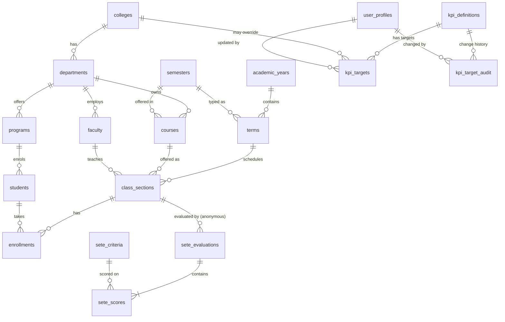

# Database schema

PostgreSQL 17 on Supabase. All objects are created by the migrations in
[`supabase/migrations/`](../supabase/migrations):

| Migration | Contents |
|---|---|
| `20261106000100_core_schema.sql` | Enum types, the 20 normalized tables, constraints, FK indexes |
| `20261106000200_security_rls.sql` | Role/scope helpers, triggers (profile bootstrap, demo-credential protection, target validation and audit), RLS policies, grants |
| `20261106000300_analytics.sql` | Materialized fact views, the KPI engine, dashboard RPCs, health probe |
| `20261111000100_academic_admin_only.sql` | Single primary user: every policy and analytics function restricted to the authorized academic administrator; no automatic profiles; case-study college names; KPI category, objective and management actions |

All rows are **synthetic demonstration data** loaded by [`supabase/seed/`](../supabase/seed).

## Entity–relationship diagram

`user_profiles.user_id` is also a foreign key to `auth.users(id)` (Supabase Auth).

## Tables

### Organization and calendar

| Table | Key columns | Notes |
|---|---|---|
| `colleges` | `id`, `code` (unique, `^[A-Z]{2,8}$`), `name` (unique) | 6 colleges following the case-study structure: CICS, CABEIHM, CTE, CHS, CCJE, CAS |
| `departments` | `id`, `college_id` → colleges, `code` (unique), `name`, `established_year` | unique (college, name); 14 departments. Nutrition and Dietetics was established in 2024, which demonstrates empty states |
| `programs` | `id`, `department_id` → departments, `code` (unique), `name` | One degree program per department |
| `academic_years` | `id`, `start_year` (unique), `label` (unique, must equal `YYYY-YYYY+1`), `start_date`, `end_date` | AY 2022-2023 … 2025-2026 |
| `semesters` | `id`, `code`, `name`, `sort_order` (all unique) | 1st / 2nd Semester |
| `terms` | `id`, `academic_year_id` → academic_years, `semester_id` → semesters, dates, SETE window, grade deadline | unique (AY, semester); date-order checks |

### People (synthetic, pseudonymous)

| Table | Key columns | Notes |
|---|---|---|
| `faculty` | `employee_no` (`^SYN-F-[0-9]{4}$`), `pseudonym` (unique), `department_id`, `academic_rank`, `employment_status`, `hired_on` | Rank and status limited by CHECK constraints; names are pseudonyms |
| `students` | `student_no` (`^SYN-YYYY-NNNNN$`), `program_id`, `entry_year`, `block_no`, `sex` | No names stored |

### Teaching and grades

| Table | Key columns | Notes |
|---|---|---|
| `courses` | `department_id`, `code` (unique), `title`, `units` (0–6], `year_level` (1–5), `semester_id` | |
| `class_sections` | `term_id`, `course_id`, `faculty_id`, `section_code`, `grades_submitted_on` | unique (term, course, section) |
| `enrollments` | `section_id`, `student_id`, `final_grade`, `remark` (`passed`/`failed`/`incomplete`/`dropped`) | unique (section, student). CHECKs keep grade and remark consistent: passed ⇒ 1.00–3.00, failed ⇒ 5.00, INC/DRP ⇒ no grade |

### SETE (anonymous)

| Table | Key columns | Notes |
|---|---|---|
| `sete_criteria` | `id`, `code` (A–D), `name`, `description` | SETE = Student Evaluation of Teaching Effectiveness. Criteria: Commitment · Knowledge of Subject · Teaching for Independent Learning · Management of Learning |
| `sete_rating_scale` | `label`, `min_score`, `max_score` | Outstanding ≥ 4.50, Very Satisfactory 4.00–4.49, … |
| `sete_evaluations` | `id`, `section_id`, `submitted_at` | **No student identifier**, which keeps responses anonymous |
| `sete_scores` | PK (`evaluation_id`, `criterion_id`), `score` (1–5) | One score per criterion per form |

### KPIs, targets and settings

| Table | Key columns | Notes |
|---|---|---|
| `kpi_definitions` | `code` (unique), `name`, `description`, `formula`, `unit` (`rating`/`percent`/`grade`), `direction` (`higher_is_better`/`lower_is_better`), `decimals`, `min_value`, `max_value`, `category` (Academic operations / Teaching effectiveness), `objective`, `warning_action`, `critical_action` | The five KPIs with their case-study objective and management actions |
| `kpi_targets` | `kpi_id`, `college_id` (NULL = institution default), `target_value`, `warning_threshold`, `critical_threshold`, `notes`, `updated_at`, `updated_by` | `UNIQUE NULLS NOT DISTINCT (kpi_id, college_id)`. A trigger validates range and order for the KPI's direction |
| `kpi_target_audit` | `kpi_id`, `college_id`, `action`, `old_values`, `new_values`, `changed_by`, `changed_at` | Append-only, written by a trigger |
| `analytics_settings` | `key`, `value`, `default_value`, `min_value`, `max_value`, `label`, `description` | `faculty_rating_standard` (4.00), `min_evaluations_reported` (5) |
| `user_profiles` | `user_id` → auth.users, `full_name`, `role`, `title`, `is_demo` | **A row here is the authorization.** CHECK `user_profiles_academic_admin_only` allows only the academic-administrator role (`admin`); accounts without a row get no data |
| `private.kpi_target_baseline` | same columns as `kpi_targets` | Seeded copy used by **Restore defaults** |

## Analytics layer

- `private.section_facts` (materialized view, one row per class section) holds the term,
  AY, semester, department, college, faculty, units, counts of
  enrolled/dropped/incomplete/passed/failed, the grade sum, grade-band counts,
  evaluations, and the SETE score sum and count.
- `private.section_criterion_facts` (materialized view) holds score sum and count per
  section and criterion.
- `private.refresh_analytics()` rebuilds both after data loads.
- `private.kpi_values(term_ids, college_id, department_id)` is the single KPI engine every
  RPC uses.

The `private` schema is not exposed through the Data API, and `anon`/`authenticated`
have no privileges on the views.

### Dashboard RPCs (`public`, callable by `authenticated` only)

All of them take `p_academic_year_id`, `p_semester_id`, `p_college_id` and
`p_department_id`, where NULL means "all". Each one starts with
`private.authorize_scope()`, which raises **42501** unless the caller is an authorized academic administrator.

| Function | Returns |
|---|---|
| `get_kpi_summary` | 5 rows: value, previous comparable period, target and thresholds (college override aware), status, sample size |
| `get_kpi_trend` | Every term × KPI for the scope; flags the selected period |
| `get_department_kpis` | Department × KPI with per-department status |
| `get_sete_criteria` | Mean per criterion for the scope vs. the institution; small-n suppression |
| `get_grade_distribution` | Grade bands (1.00–1.50 … DRP) with counts and percentages |
| `get_faculty_performance` | Faculty-level SETE results (pseudonymised), with small-sample suppression |
| `reset_kpi_targets` | Restore seeded targets and settings (academic administrator only) |
| `app_health` | Callable by `anon` too. Non-confidential counts for `/api/health` |

## Indexes

Every foreign key has an index, for example `departments_college_id_idx`,
`class_sections_course_id_idx`, `class_sections_faculty_id_idx`,
`enrollments_student_id_idx`, `sete_evaluations_section_id_idx`,
`sete_scores_criterion_id_idx`, `kpi_targets_college_id_idx` and the audit indexes.
Unique constraints provide the rest, such as `(term_id, course_id, section_code)` and
`(section_id, student_id)`. The fact views are indexed on `section_id`,
`(term_id, department_id)` and `faculty_id`.

## Seed data (synthetic)

The seed is deterministic: the PRNG is a stable hash of a text key, so re-seeding
produces identical data.

| Entity | Rows |
|---|---|
| Colleges / departments / programs | 6 / 14 / 14 |
| Academic years / terms | 4 / 8 |
| Courses | 560 |
| Faculty / students | 145 / 5,149 |
| Class sections | 3,230 |
| Enrolments (final grades) | 107,840 |
| SETE evaluation forms / criterion scores | 88,512 / 354,048 |

Each department has its own parameters (difficulty, attrition, response propensity,
teaching-quality effect). There is a gentle improvement trend over the years, and
teaching quality correlates mildly with grades. Some departments therefore cross warning
or critical thresholds; for example Mathematics, Accountancy and Criminology (GWA, faculty meeting the standard).
